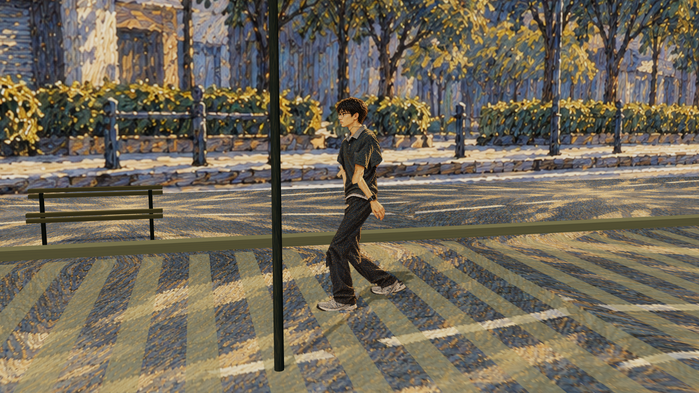

# 51秒梦境二维曲线动画

**最新：v04 侧面步态与空间层次预览，待评审。** 全片目标为1920×1080、30fps、51秒、7镜；尚未完成最终成片。

- [打开最新预览](previews/v04-sidewalk/README.md)
- [查看全部版本](previews/README.md)
- [查看用户意见日志](feedback/2026-10-26.md)

## 已确认与当前修改

用户已确认B方向的油画/素描曲线画风，并认可v03自然的人物比例。当前改善纸片感、步态与脚底接地，测试侧面视角、适度空间体积和更抽象的排线。动态效果仍待评审。

## 项目资料

- [持续约束](AGENTS.md)
- [项目规格](PROJECT_SPEC.md)
- [七镜分镜](SHOTLIST.md)
- [声音要求](AUDIO_PLAN.md)
- [真实进度](PROGRESS.md)
- source/保留原始Word和Excel附件。

各版预览文件已实际归档；图片、视频、原始下载包及来源记录分别保存，feedback.md逐版记录原话、认可项和修改项。当前预览分支用于审核，不将艺术测试通过等同于51秒成片完成。动画工程源码仍保存在当前Cloud工作区，尚未随预览发布。
