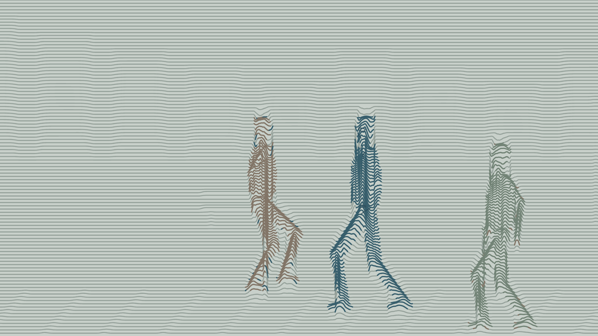

# 51秒梦境二维曲线动画

**最新：v06 人物细节与柔和分色预览；v05线条效果已获用户认可。** 全片目标为1920×1080、30fps、51秒、7镜；尚未完成最终成片。

- [打开最新预览](previews/v06-details/README.md)
- [查看全部版本](previews/README.md)
- [查看用户意见日志](feedback/2026-10-26.md)

## 已确认与当前修改

用户明确认可v05粗平行线的效果。当前保留这套线条机制和自然比例，增加手表、兜口、手部和手机细节，测试左手取出—看手机—放回，并以协调的蓝灰/灰褐/灰绿区分主角、路人与背景。新增动作与色彩仍待本版审看。

## 项目资料

- [持续约束](AGENTS.md)
- [项目规格](PROJECT_SPEC.md)
- [七镜分镜](SHOTLIST.md)
- [声音要求](AUDIO_PLAN.md)
- [真实进度](PROGRESS.md)
- source/保留原始Word和Excel附件。

各版预览文件已实际归档；图片、视频、原始下载包及来源记录分别保存，feedback.md逐版记录原话、认可项和修改项。当前预览分支用于审核，不将艺术测试通过等同于51秒成片完成。动画工程源码仍保存在当前Cloud工作区，尚未随预览发布。
