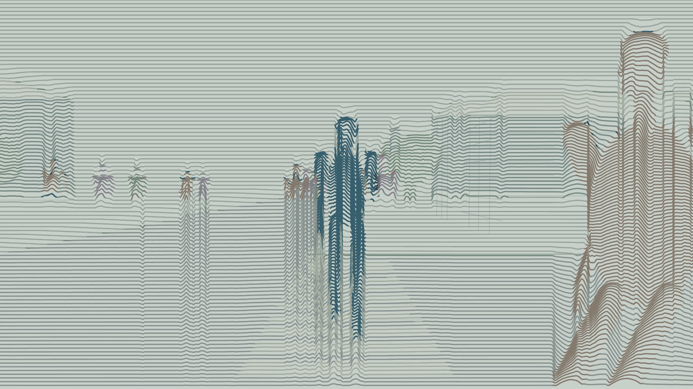

# 51秒梦境二维曲线动画

**最新：v07 · 51秒七镜完整版。** 1920×1080、30fps、1530帧；沿用已认可的v06方向，新增城市背景与分层人流，含中文合成女声和完整声音设计。首版整片待审看。

- [打开最新预览](previews/v07-full/README.md)
- [查看全部版本](previews/README.md)
- [查看用户意见日志](feedback/2026-10-27.md)

## 已确认与当前修改

用户认可v06方向并授权生成完整视频，要求注意背景、路人更多但不乱。v07以固定城市地图、30名固定身份行人和分层路线回应；主角/手部保持深蓝灰，背景与周边行人降低视觉重量。七镜按原51秒分镜合成，新增内容仍待整片观看反馈。

## 项目资料

- [持续约束](AGENTS.md)
- [项目规格](PROJECT_SPEC.md)
- [七镜分镜](SHOTLIST.md)
- [声音要求](AUDIO_PLAN.md)
- [真实进度](PROGRESS.md)
- source/保留原始Word和Excel附件。

各版预览文件已实际归档；图片、视频、原始下载包及来源记录分别保存，feedback.md逐版记录原话、认可项和修改项。当前预览分支用于审核，不将艺术测试通过等同于51秒成片完成。动画工程源码仍保存在当前Cloud工作区，尚未随预览发布。
