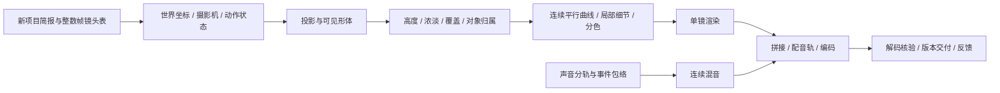

# 可复用工作流总结：平行曲线动画制作

版本：1.0 · 2026-10-27。目的：把新分镜、新脚本变成风格一致的作品。当前v08只作为已完成的实现与视觉参考。

下一位执行者先读[交接手册](HANDOFF_GUIDE.md)。本文件解释“怎么组织工作、为什么这样做”；交接手册负责“收到新脚本后具体从哪里开始”。

## 1. 可复用的核心与每次重新决定的内容

| 层次 | 应保留或复用 | 随新项目替换 |
|---|---|---|
| 视觉机制 | 较粗、连续的平行曲线；弯折塑形、疏密塑造浓淡；运动时线条随形体律动 | 曲线具体参数、材质强度、分辨率适配 |
| 视觉秩序 | 自然比例、基本轮廓、动作/道具可辨；前景主角与背景有层次 | 人物身份、服装、配饰、主次关系与具体色盘 |
| 色彩倾向 | 低饱和、统一色调；避免突兀跳色和细碎油画贴图 | 情绪、明暗、冷暖由新脚本决定，不强制每次忧郁 |
| 动作与空间 | 稳定身份、固定骨长、支撑脚锁定、道具绑定、统一世界坐标 | 骨架比例、动作类型、路线、景别、摄影机路径 |
| 制作组织 | 资料归一→短样→分镜生产→分轨声音→验证→逐版交付 | 镜头数、总时长、fps、画幅、声音与交付目标 |

**不能自动继承的旧剧情：** 51秒、七镜、男主年龄/身高/眼镜/左腕表、十字路口/长椅/手机、固定左手动作、无人声、来电模糊、信号紊乱和白场结尾。这些是本片设置；新脚本有新要求时按新要求重建。没有新要求的画风机制可直接沿用，不必重新探索油画或平涂方向。

## 2. 输入整理与需求优先级

每次先建立项目简报：原始脚本/表格/参考图、角色身份表、镜头表、空间图、声音事件表、输出规格、验收重点、授权范围。保留原件，补充解释单独记录，不改原文来掩盖冲突。

执行优先级：当前用户明确要求 > 当前项目已确认简报与反馈 > 原始脚本/附件 > 可测试制作建议 > 历史案例。旧聊天不是必要输入；必要决策写入文件。

硬约束和建议必须分开：例如“手从左兜拿手机”是动作约束；“线宽4像素”是1080p参考参数。新脚本未提供的台词、界面个人信息和剧情不得自行补造。缺信息先查项目资料，只询问真正影响下一步的缺口，其他工作继续。

## 3. 从需求到交付的阶段

| 阶段 | 输入 | 交付/检查点 | 可以恢复的位置 |
|---|---|---|---|
| P0 接手与建模 | 新脚本、附件、最新用户意见 | 简报、约束/未知项、整数帧镜头表、空间与道具连续性表 | 已读取文件和待确认项 |
| P1 风格落地 | 已认可风格参考、新角色/场景 | 关键帧、短动作样片；确认同风格在新对象上仍清楚 | 已选参数、参考图、拒绝方向 |
| P2 高风险动作 | 取物、接触、坐下、转身、摄影机变化等 | 接地/骨长/左右手/遮挡/取景验证；手机等道具保持身份 | 已通过动作与已知缺陷 |
| P3 全片粗排 | 全镜头与声音事件 | 粗剪/关键帧联系图，核对叙事顺序、镜头衔接和总帧数 | 每镜状态与事件时间 |
| P4 逐镜制作 | 已通过的造型和动作机制 | 独立单镜视频、阶段关键帧、音频分轨 | 已完成镜头与渲染指纹 |
| P5 合成与核验 | 全部单镜和连续混音 | 完整视频、低清观看版、媒体与艺术检查记录 | 失败镜头或失败导出步骤 |
| P6 发布与收尾 | 已核验产物 | 实际版本目录、反馈日志、源码/资源恢复包、总结交接 | Git提交、包哈希、入口、下一步 |

沿用风格时，P1用新角色和最难镜头做短验证即可，不重复询问已经确认的审美。静态参考图通过不代表动画材质和动作已经通过；新镜头的重大新假设仍需可观看的证据。授权已明确覆盖的制作和修复继续执行，不把每次技术检查变成新的许可步骤。

## 4. 实际技术管线

- **时间轴：** TypeScript/React/Remotion负责按帧组织镜头。区间用[start,end)，总帧数是各镜frames之和，避免秒与帧混用。
- **场景与动作：** 在稳定的世界坐标里组织几何、角色、道具和摄影机。用透视投影和近裁面裁切提供空间感，画面由Canvas二维曲线输出。
- **线场：** 解析形体生成高度、浓淡、覆盖和对象归属；平滑高度后，以局部正密度积分调整线距，再对同一线族弯折。常态保持线序，避免逐帧随机重画。
- **细节与颜色：** 眼镜、兜口、手指、道具边缘等只补必要笔画。颜色由可见对象归属控制，使主角、路人、背景区分而协调。
- **运动：** 骨架+双骨IK，区分膝和肘的弯向；支撑脚锁定世界位置。道具位置与手、口袋等状态连续。高度变化、移动与转身分别计算。
- **声音：** Python/NumPy/SoundFile制作或整理分轨，再按事件包络混合。是否人声、音乐、字幕每个新项目单独确定；外部素材记录来源和许可。
- **输出：** 单镜无声画面完成后拼接，再一次性配连续音轨，使用FFmpeg导出H.264/AAC和观看版，ffprobe检查实际规格。

基线参考参数（1080p）：画布1920×1080；网格DX=4、DY=3；主线间距10.5px；线宽约3.35–4px。纸色#c8d0ca、主角墨色#355d6b为参考。它们不是所有画幅的硬参数，改变尺寸要同时处理网格、投影中心、线宽与界面坐标。

## 5. 模块边界与新项目适配

| 模块 | 复用价值 | 新项目工作 |
|---|---|---|
| src/parallel/field.ts | 线场、体积/疏密、基础形体数据结构 | 保持渲染机制，按分辨率/对象扩充形体 |
| src/spatial/gait.ts | 双骨IK、关节弯向、步态与支撑脚 | 核对新比例、动作、速度与前进方向 |
| src/projection.ts | 空间投影 | 定义新相机、焦距/构图、世界坐标约定 |
| src/film/scene.ts与actor.ts | 组装场景、角色绘制与身份归属 | 替换新角色、场景和对象，保留线场接口 |
| src/film/model.ts、city.ts、pov.ts | 本片动作/城市/主观镜头的可参考实现 | 它们仍是剧情代码，不能直接当通用脚本解析器 |
| src/film/Film.tsx、ending.ts | Canvas绘制、界面与特效接入 | 接新项目场景；按新脚本决定是否有界面和结尾效果 |
| src/timeline.ts、src/Root.tsx | 镜头注册、帧区间和输出规格 | 替换新时长/镜头数；清理旧事件和状态标记 |
| scripts/render-film.mjs、film-fingerprint.ts | 单镜输出、恢复与绘制输入指纹 | 同步改硬编码帧号、循环、输出名、编码指纹 |
| scripts/make_film_audio_v08.py | 分轨/包络/混音示例 | 更换新音源、事件和时长，勿复制旧声景 |

现有实现是**可复用渲染基线+剧情夹具**，还不是“换一个JSON就自动出任意影片”的产品。templates/中的表格是输入约定，未接入通用加载器。下一步可优先把规格、事件、动作状态和渲染出口从剧情代码中抽成配置，再扩展新动作库；本次交接没有声称这些重构已完成。

## 6. 进度、版本与恢复结构

建议新项目以项目ID隔离：source/保存原件，brief/保存简报与镜头/声音表，scene/、actions/、camera/和audio/保存剧情实现，out/shots/保存可恢复输出，releases/vNN/保存交付。对应模板已实际放在[templates/](templates/)。这是推荐布局，不是已有自动生成器。

每次写进度：当前阶段、实际完成项、路径、源码/输入指纹、验证结果、已知问题、缺少资源、下一条可执行步骤、Git状态。只写已经完成的结果，不把计划或文件名当产物。

复用旧镜头前核对完整绘制输入及公共渲染器/字体/编码参数；.partial不算完成。音频改动与画面改动分开判断，不因旧文件存在就跳过。反馈以“原话/认可项/修改项/落实版本/验证/状态”记录，媒体不覆盖旧版本。

发布前完成可审核结果，再按本项目已有授权发布。推送范围、目标仓库和分支随项目确认，旧项目权限不自动扩展到所有新仓库。不要提交依赖目录、缓存、密钥、未完成文件或无关素材。

## 7. 本次实践得到的关键教训

| 问题 | 原因/结论 | 固化为后续规则 |
|---|---|---|
| 只像均匀条纹或细腻油画 | 表面纹理没有真正承担形体与明暗 | 从体积/线距出发，使用实际动画验证，不沿旧探索方向量产 |
| 纸片缩放感 | 只移动/缩放整张人物 | 用关节动作、接地和空间投影驱动形体 |
| 肘关节反向 | 骨长正确但弯向错误 | 单独测膝/肘方向，不能只验长度 |
| 斜走时脚滑 | 骨架前向与实际路线不一致 | 核对世界坐标中的支撑脚与行进方向 |
| 下半身消失 | 大地面按一个参考点深度排序，盖住人物 | 地面/斑马线置于角色下方，检查可见对象归属与鞋部取景 |
| 道具动作难辨 | 抽象轮廓掩盖手指/口袋/界面 | 保留必要局部细节，验证取出、持握、放回与接触点 |
| 风格迭代后资料冲突 | 旧反馈盖过新要求 | 最新明确反馈优先，历史原件与版本保留并标注 |
| 聊天文件空白或环境丢失 | 只有Cloud路径/媒体，没有可访问恢复入口 | 提供GitHub实际文件、两份手册及可验证源码/资源包 |

## 8. 验收与已知边界

检查分为艺术与技术两部分：艺术看线条语言、动作可读性、主次和情绪；技术看帧数/时长、身份/道具连续、骨长/弯向/接地、遮挡/构图、同帧重现、资源许可、音轨来源/峰值/同步和完整解码。技术通过不能代替艺术判断。

当前交接基线只验证既有角色和动作：平面双骨IK不是完整三维人体/手指系统；新动作、新角色种类、复杂接触/物理、4K和其他fps均需适配验证。Linux/Chromium已运行，Mac开发环境和跨平台逐像素一致性尚未实机验证。高复杂度镜头不能用固定时长承诺自动完成。

已完成参考、工程包、恢复命令和下次可直接使用的启动提示词，见[交接手册](HANDOFF_GUIDE.md)。
