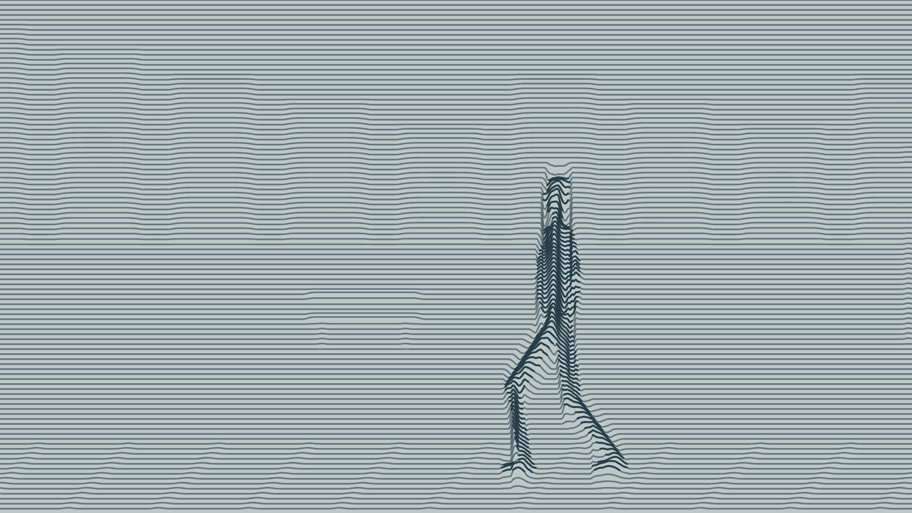
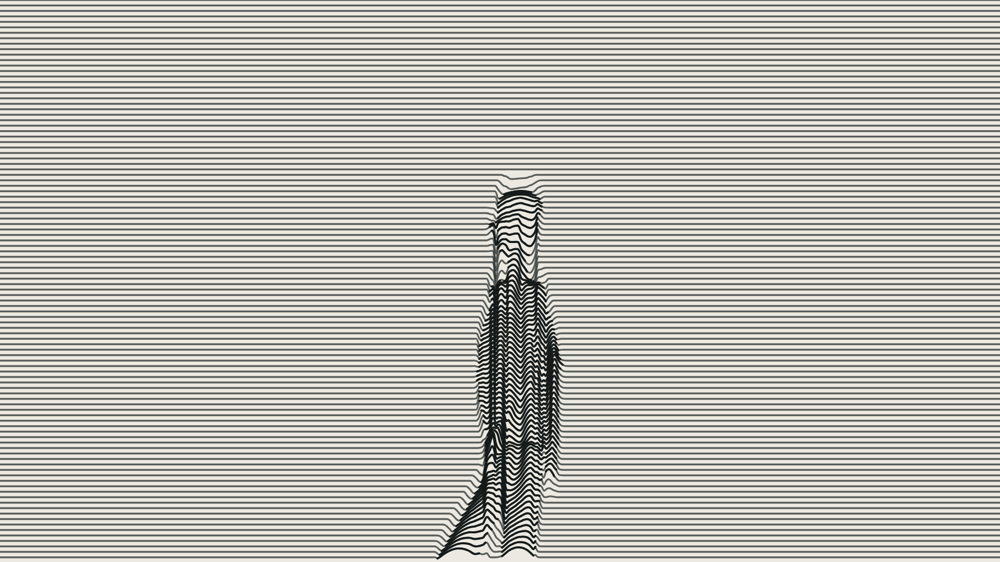

# v05 · 粗平行曲线与律动

[本版日志](feedback.md) · [全部版本](../README.md) · [意见总日志](../../feedback/2026-10-26.md)

- [720p动作预览](videos/preview-720p.mp4)
- [1080p动作预览](videos/preview-1080p.mp4)
- [离线播放包](downloads/v05-preview.zip)

## 与上版的变化

- 本版以用户新提供的手形平行线参考为准，取消细腻油画贴图，直接以程序绘制粗平行曲线。
- 同一组连续线在形体上弯折，利用局部线距收紧/放宽表示浓淡；人物、街道基本轮廓由线场浮现。
- 运动来自关节姿态、体积和连续线场的变化；不靠人物整体缩放。
- 膝盖向前弯、手肘向后弯，分别求解并新增方向测试；不再使用带预置弯曲姿势的绘画肢体。

## 黑白近景对照

[查看侧面关节方向检查图](records/joint-directions.png)

本版仍是8秒独立风格与动作测试，不是某个正式分镜完成。低饱和蓝灰用于动作样片，黑白近景用于对照线条机制；最终色彩与抽象程度待本轮反馈。没有正式对白，只有临时环境底声。
