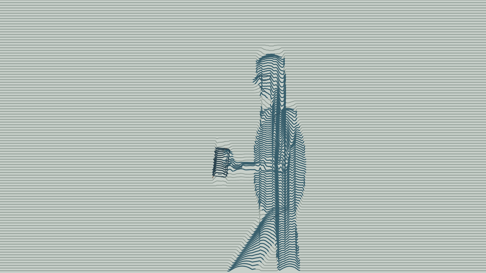
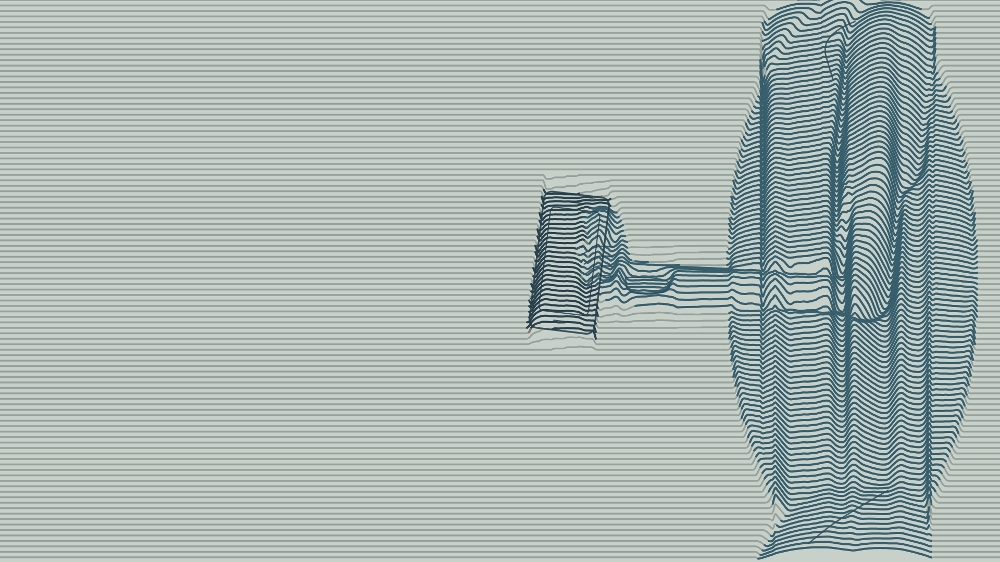

# v06 · 人物细节与柔和分色

[本版日志](feedback.md) · [全部版本](../README.md) · [意见总日志](../../feedback/2026-10-26.md)

- [9秒配色与人物动作预览 · 720p](videos/preview-720p.mp4)
- [9秒预览 · 1080p](videos/preview-1080p.mp4)
- [6秒手部近景测试 · 720p](videos/hand-detail-720p.mp4)
- [全部预览离线包](downloads/v06-preview.zip)

## 本版改进

保留用户已认可的v05粗平行曲线机制、自然比例和线场律动。人物仍由同一组连续线条的弯折和疏密构成，没有恢复油画贴图或实体填色。

- 主角：低饱和深蓝灰；路人：灰褐与灰绿；背景：较淡灰绿。通过线条颜色及浓淡区分，不用明亮跳色。
- 局部补充眼镜、侧脸、Polo领口、左腕手表、裤兜开口、手掌与四指提示。
- 左手接近左裤兜、手机逐渐露出、屈肘抬起、低头看手机、放回兜口后松手。手机随手部运动，并受兜口遮挡；近景可单独看握持和边缘细节。

## 如何观看

9秒主预览前3秒看街道侧面的主角/路人/背景分色，随后切到6秒上半身动作。手部近景为同一个6秒动作的放大测试。

本版是独立的风格与动作可读性测试；放回用于检验物体连续性，不代表改写正式分镜的机位或动作时间。不是51秒成片，也没有完成拒接、捂胸或正式对白。声音只有临时城市底声。新增细节与颜色仍待本版反馈。
