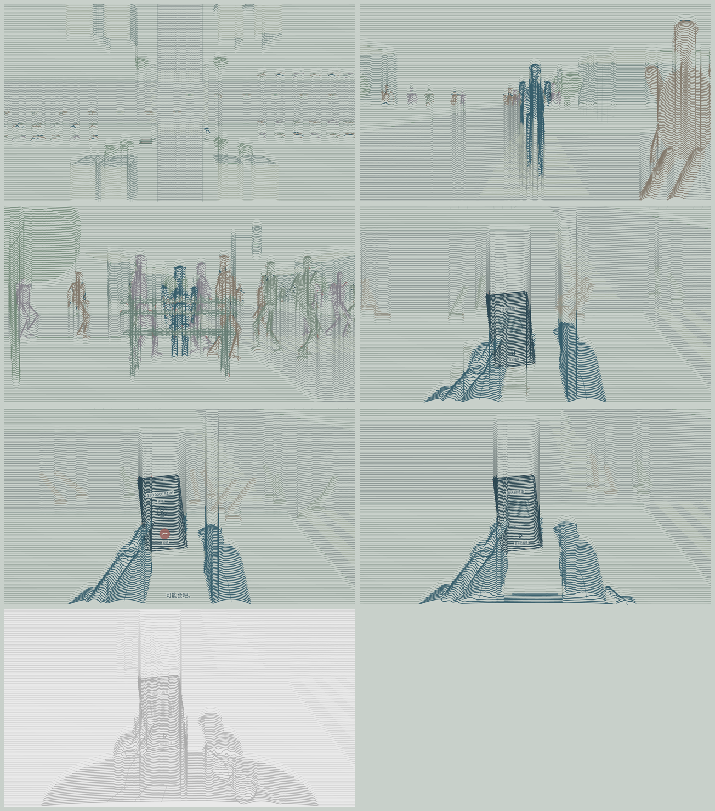

# v07 · 51秒七镜完整版

[本版反馈记录](feedback.md) · [全部版本](../README.md) · [2026-10-27意见日志](../../feedback/2026-10-27.md)

- [观看/下载51秒完整版 · 720p](videos/dream-51s-720p.mp4)
- [观看/下载1080p原版](videos/dream-51s-1080p.mp4)
- [720p离线播放包](downloads/v07-film.zip)
- [三句对白字幕](records/dialogue.zh.srt)
- [技术核验](records/verification.json) · [声音来源](records/audio-provenance.json)

## 内容

保留v06已认可的粗连续平行线、自然比例、人物细节与低饱和分色；同一线族通过弯折、疏密和律动表现形体与动作。

城市背景使用固定世界坐标：四角楼群、树冠、宽马路、斑马线、交通信号灯、长椅和连续车流。30名固定身份行人分层行走；主角附近留出空间，主观镜头周边的人流更淡，避免掩盖手机和手部。

| 时间 | 镜头 |
|---|---|
| 00:00–00:10 | 路口俯视下降、旋转，靠近男主背影 |
| 00:10–00:16 | 人流中的正面中景，左手取手机、扫一眼后放回 |
| 00:16–00:24 | 左侧跟随，走向西南角信号灯旁长椅、坐下 |
| 00:24–00:28 | 坐姿主观视角，低头、左手取手机，播放短暂耳机音乐 |
| 00:28–00:38 | 来电/震动、两位女声，右手食指缓慢靠近并拒接 |
| 00:38–00:46 | 拒接后仍有女声，进一步低头、右手轻捂胸和微弱呼吸 |
| 00:46–00:51 | 失色、渐淡至白场，所有声音渐弱至无声 |

## 声音

三句台词均已实际生成：女主“你觉得他能接吗？”，停顿一秒后女二“可能会吧。”，拒接后女主“唉，看来还是不想见我。”。两位女声为本地Kokoro中文合成，没有克隆真人声；模型Apache-2.0、推理包MIT，下载来源与哈希已记录。

交通、人群无语义低语、脚步、坐椅、铃声/震动、微弱呼吸和4秒剧情耳机乐句均为本项目原创程序合成；没有使用第三方影视/商业音乐录音。耳机乐句在28秒来电时停止，拒接后保持暂停。对白附简洁字幕。

本版是首版51秒完整影片，等待整片观看后的反馈；不能把技术核验等同于背景、动作或合成配音的艺术验收。Mac仍未实机验证。

用户随后认可整体并提出四项修改，更新见[v08](../v08-revision/README.md)及[反馈原话](feedback.md)。
