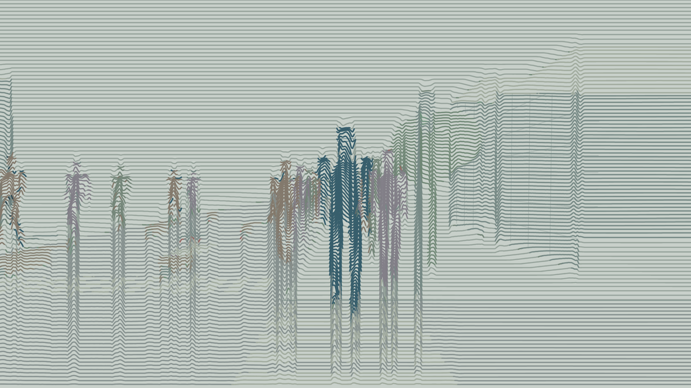
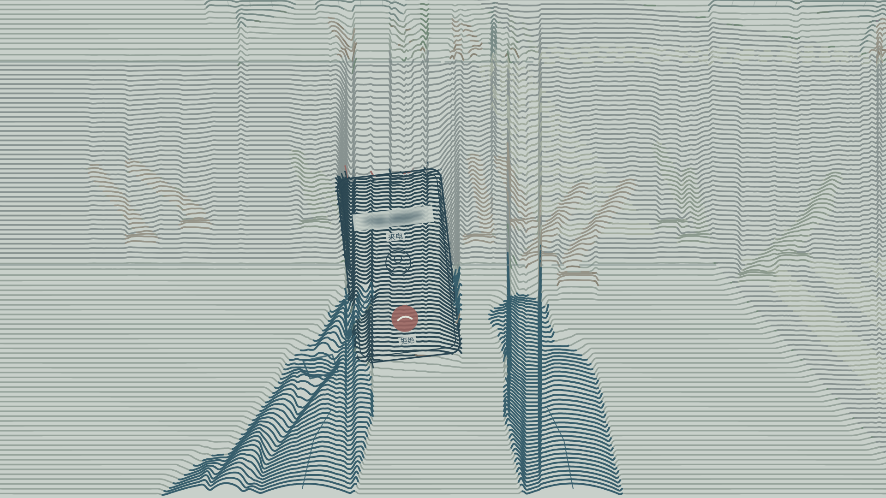
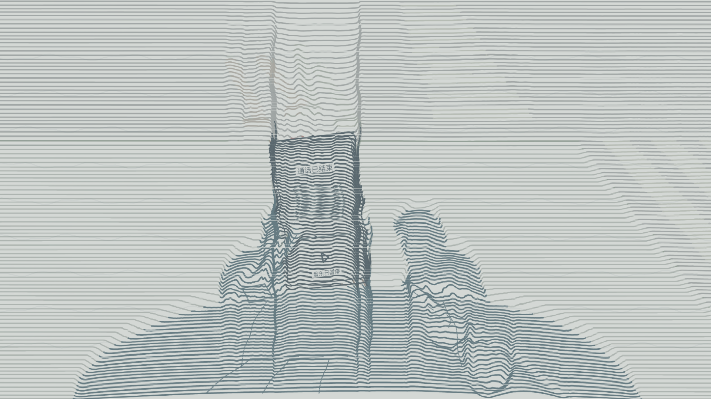

# v08 · 无人声、模糊来电与信号式结尾

[本版反馈记录](feedback.md) · [全部版本](../README.md) · [用户意见日志](../../feedback/2026-10-27.md) · [技术路线](../../TECHNICAL_ROUTE.md)

- [观看51秒完整版 · 720p](videos/dream-51s-720p.mp4)
- [观看/下载1080p原版](videos/dream-51s-1080p.mp4)
- [只看5秒结尾](videos/ending-720p.mp4)
- [720p离线播放包](downloads/v08-film.zip)
- [本版技术说明副本](records/technical-route.md) · [技术核验](records/verification.json) · [声音来源](records/audio-provenance.json)

[查看修复前v07第320帧](records/before-v07-frame320.png)，可与上图同一帧对照。

## 本版四项修改

- **去人声**：对白、人群低语、呼吸声、对白回声及字幕已移除。车流、脚步/坐椅、电话铃声/震动和第4镜短暂的耳机器乐保留；从四条非人声分轨重新混音。
- **来电模糊**：号码区域直接绘制模糊图形，没有真实或随机数字藏在模糊层下面；保留来电与拒接按钮。
- **下半身补全**：修复地面和斑马线错误覆盖腿部的层级问题；双腿始终由完整骨架生成，并检查鞋子处于走路镜头的取景范围内。长椅段视角稍作调整，减少遮挡。
- **信号式结尾**：最后5秒加入数像素级晃动、轻微旋转、扫线错位和扰动曲线，随后失色、渐白，最后一帧仍为白场。

七镜时长仍为10/6/8/4/10/8/5秒，总计51秒、30fps、1530帧。自然比例、粗平行曲线、柔和分色及分层人流保留。历史v07视频与原ZIP完整保留，本版修改效果待审看。
