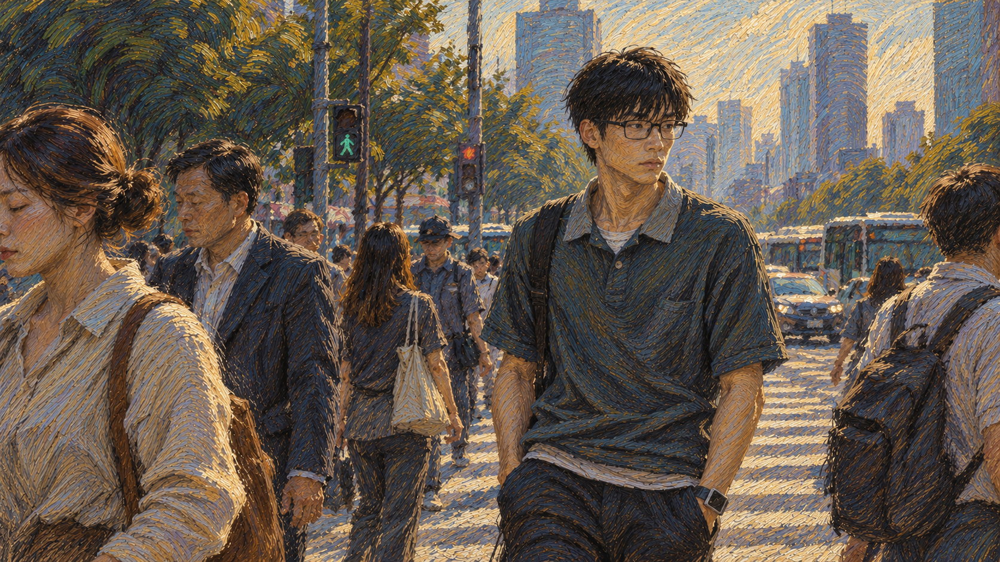
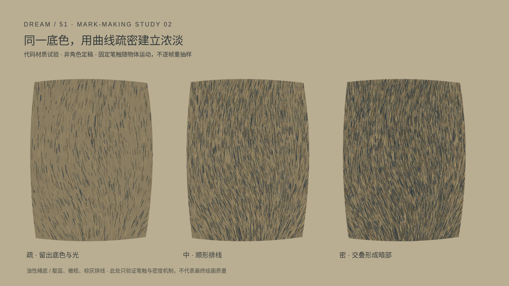

# 美术方向修正 v0.2：油画与素描之间

本轮依据用户反馈重做：密集、沿形体流动的曲线排线，用疏密和交叠表现颜色浓淡；深沉的油画颜料感；男主高但不异常突出，人体比例自然。

**下面两张是生成的静态美术方向图，不是已经实现的新动画。** 颜色、人物普通感与笔触仍待确认；v0.1平涂矢量风格已被否定。

## A · 偏油画色层与素描笔触

## B · 更强调密集曲线与排线（本轮主要候选）

两张构图采用同一人物与街道场景，供比较笔触。B强化细密的随形曲线与色线交叠；A保留更多油画色层。请重点判断笔触是否接近预期、颜色是否需要进一步压暗或降低金黄色，以及人物是否仍显得过于漂亮/突出。

## 代码验证：同色底上的疏密变化

[4秒笔触稳定性测试MP4](stroke-stability-4s.mp4)

这张材质实验和4秒视频由代码渲染，区别于上面的生成概念图。三块使用相同底色和色系，改变线条密度；笔触使用固定种子，不逐帧重抽样。它只验证材质机制，尚未实现概念图中的完整人物、城市或绘画质量。视频960×540、30fps、120帧，无音轨。

## 查看方式

- 此页面可直接查看图片；点击图片可放大。
- [下载本轮完整ZIP](../style-v02.zip)，解压后双击 `index.html` 离线查看两张方向图和材质测试。
- [旧版v0.1](../prototype-v01/README.md)只保留作比较，不代表继续采用。

艺术验收前不重做整片。新的角色轮廓、脸部普通感、暗部层次和周围人群尺度仍需继续细化。
